::: cover
# FastIdentity

## Platform guide

**First-party, consent-first identity resolution for B2C websites**

Pixel · Identity graph · Abandonment flows · GDPR / PECR compliance

*identity.fastsme.com · November 2026*
:::

---

## 1. Executive summary

**What it is.** FastIdentity is a self-hosted identity layer for consumer websites. A small consent-aware pixel and a server API collect first-party events. An identity graph then stitches anonymous browsing to known people, and an activation layer triggers abandonment emails through the ESP you already use.

**Why it matters.** Most visitors to a high-consideration site (medical travel, finance, property) browse anonymously for weeks before enquiring. Third-party cookies and ad-tech IDs are gone or unreliable. First-party identity, built on consent, is now the only durable way to recognise a returning visitor and follow up at the right moment.

**How it works.**

- **Deterministic first.** Email, phone, user ID and CRM ID merge profiles with certainty, and every merge can be undone.
- **Probabilistic second, and only with consent.** A Fellegi–Sunter model scores device and network signals, which are stored as keyed hashes and never as raw fingerprints. Matches above 97% merge automatically; matches between 70% and 97% go to a human review queue. An ambiguity guard never auto-merges an anonymous visitor who resembles two known people.
- **Compliance built in.** It keeps a consent ledger per purpose and legal basis, maps CookieYes, OneTrust and Google Consent Mode v2 consent automatically, and handles PECR soft opt-in. Suppression is hashed, every action is audit-logged, and right-to-erasure and data-export (DSAR) requests are served through an API.

**Where we are.** The platform is live at `identity.fastsme.com` on the FastSME Coolify stack: UK data region, PostgreSQL, CI/CD on every push to `main`, and 30 automated tests. The first customer integration is **MyMedicalGateway**; see Section 8.

---

## 2. Contents

::: toc
1. Executive summary
2. Contents
3. Comparables — B2C identity resolution in the EEA
4. Overview — dashboard
5. Identity graph — profiles, events, merge candidates, match quality
6. Activation — segments, flows, destinations
7. Compliance — consent, privacy requests, audit log
8. Setup — sources & pixel, MyMedicalGateway integration
9. Operating playbook
:::

An animated walkthrough of every screen is in `docs/demo/fastidentity-walkthrough.gif`.

---

## 3. Comparables — EEA-native identity & CDP vendors

::: wide
| Vendor | HQ | What they resolve | Model | Relevance to us |
|---|---|---|---|---|
| **Zeotap** | Berlin, DE | First-party CDP with its own identity graph; strong on consent and EU hosting | SaaS, enterprise | Closest positioning ("privacy-first CDP"), aimed at telco and retail enterprises |
| **Utiq** | Brussels, BE | Telco-network IDs (a JV of Deutsche Telekom, Orange, Telefónica and Vodafone); per-site opt-in | Network-level ID for publishers and advertisers | Ad-tech addressability, not CRM-grade stitching |
| **Bloomreach** (ex-Exponea) | Bratislava, SK / US | Engagement CDP: profile merging on customer IDs, plus email and SMS | SaaS suite | Bundles ESP and CDP; high switching cost |
| **Synerise** | Kraków, PL | AI-driven CDP with identity stitching and real-time segments | SaaS suite | Retail and banking focus in CEE |
| **Meiro** | Prague, CZ | Composable CDP with deterministic stitching; can be self-hosted | Software + services | Similar "own your data" pitch; deployments are heavier |
| **Commanders Act** | Paris, FR | Tag manager + CMP + CDP in one stack | SaaS suite | Strong on French consent rules (CNIL) |
| **Snowplow** | London, UK | Behavioural event pipeline with identity stitching in the warehouse | Open core / SaaS | Pipeline, not activation; needs a data team |
| **ID5** | London, UK | Universal ad ID built from hashed email and probabilistic signals | Ad-tech ID | Advertising only; no CRM graph |
:::

<p class="note">Compiled from vendors' public positioning as of November 2026; check before using externally. "EEA-native" means headquartered or primarily hosted in the EEA or UK.</p>

---

## 3. Comparables — global incumbents operating in the EEA

::: wide
| Vendor | What they resolve | EEA posture | Gap FastIdentity fills |
|---|---|---|---|
| **Twilio Segment** (Unify) | Deterministic profile stitching across sources | EU workspace region available | Priced per tracked user; probabilistic matching not consent-gated per purpose |
| **mParticle** (IDSync, now Rokt) | Rule-based identity strategies for apps and web | EU data residency available | Mobile-first and enterprise-priced |
| **Tealium** (AudienceStream) | Visitor stitching on attributes | EU hosting; bundled consent tooling | Tag-manager-centric and heavy to run |
| **Adobe Real-Time CDP** / **Salesforce Data Cloud** | Enterprise identity graphs inside each vendor's own suite | EU regions | Suite lock-in; long implementations |
| **Amperity** | ML identity resolution for retail | EU instances for large brands | Enterprise only |
| **LiveRamp** (RampID, ATS) | Offline + online identity graph for advertising | Large EU footprint | Ad-tech oriented; data leaves your perimeter |
| **Klaviyo** / **Braze** / **Customer.io** | Profile merging inside the ESP | EU data centres | Each ESP sees only its own events; no cross-channel graph |
| **Splink** (open source, UK MoJ) | Probabilistic record linkage | Runs anywhere | A library rather than a product; FastIdentity can use it as an optional engine |
:::

**Our wedge.** These vendors cover the enterprise suite and the ad-tech ID ends of the market. FastIdentity aims at the gap between them for SMEs in regulated, high-consideration B2C markets:

- it is self-hosted in the UK or EU and sits next to the ESP the business already uses;
- its consent is purpose-level and covers health-adjacent data;
- probabilistic matching is gated on consent and protected by the ambiguity guard;
- it costs a fraction of an enterprise CDP.

---

## 4. Overview — dashboard

:::: split
::: txt
The **dashboard** is the daily health check.

- **Live / known profiles**: how much of the audience is identified.
- **Email-contactable**: known profiles with valid `marketing_email` consent. This is the real addressable audience.
- **Consent drops**: events discarded because the visitor declined analytics. A rising number usually means a broken CMP mapping.
- **Pending merges**: items waiting in the review queue.
- **Recent activity**: the same entries as the audit log (merges, consent changes, flow runs, logins).
:::
::: shot
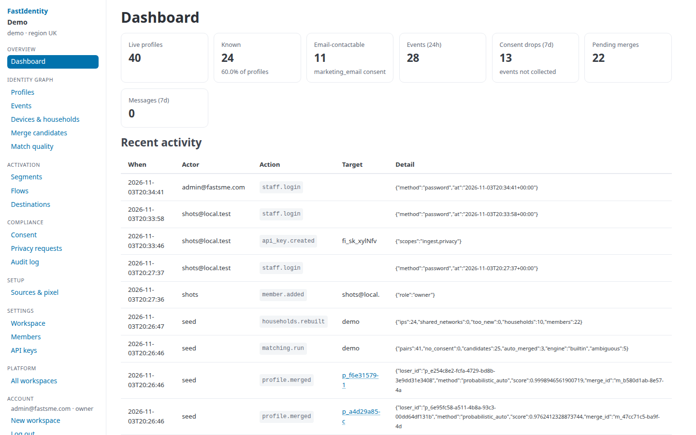
:::
::::

---

## 5. Identity graph — profiles

:::: split
::: txt
**Profiles** lists every person the graph knows about. They are either *known* (they have an email, phone or user ID) or *anonymous* (a consenting browser only).

Search by email, phone or ID. A merged profile disappears from the list. Its identifiers move to the surviving profile, and the merge can be **unmerged** later if it was wrong.

Anonymous profiles that never become known are deleted automatically after 90 days (`ANON_PROFILE_RETENTION_DAYS`).
:::
::: shot
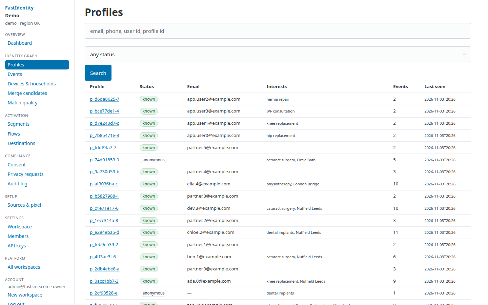
:::
::::

---

## 5. Identity graph — unified profile

:::: split
::: txt
One page shows a single person.

- **Identifiers**: every anonymous ID, email, phone and user ID linked to the person, with first-seen dates.
- **Hashed signals**: device, /24 network, browser family, timezone and language. These are stored only as keyed hashes, and only with `identity_resolution` consent.
- **Consent**: the current state of each purpose, with its source and legal basis. Staff can record an opt-in or a withdrawal here.
- **Interests**: treatments and hospitals viewed, counted from events.
- **Actions**: export (DSAR), sync to a destination, or **erase** (right to erasure).
:::
::: shot
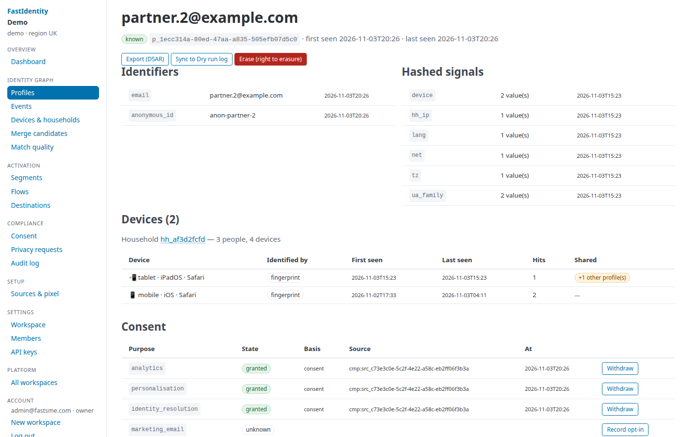
:::
::::

---

## 5. Identity graph — event stream

:::: split
::: txt
**Events** is the raw first-party stream: page views, custom events such as `treatment_viewed` or `enquiry_started`, and identify calls.

Each event records the profile it belongs to now and the profile it **originally** arrived on. That is what makes a clean unmerge possible.

PII keys (`email`, `phone`, `name`, …) are stripped from event properties before storage. Identity data goes only through `identify`.
:::
::: shot
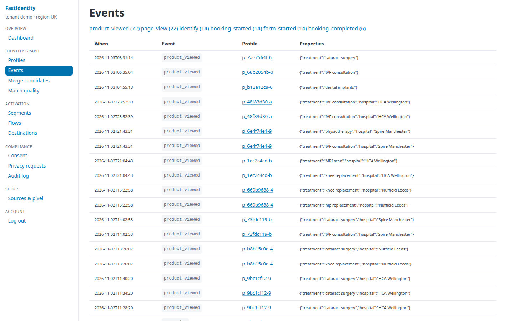
:::
::::

---

## 5. Identity graph — merge candidates

:::: split
::: txt
The **probabilistic matcher** runs every minute. It compares profiles that share a blocking key (device or network hash), then scores each pair with Fellegi–Sunter weights.

- **≥ 0.97** merges automatically, but only when every profile involved has `identity_resolution` consent.
- **0.70 – 0.97** goes into this review queue, where staff accept or reject.
- **Ambiguous**: an anonymous visitor who resembles more than one known person is never auto-merged; shared family devices are the usual cause.
- Two *known* people are never merged automatically.
:::
::: shot
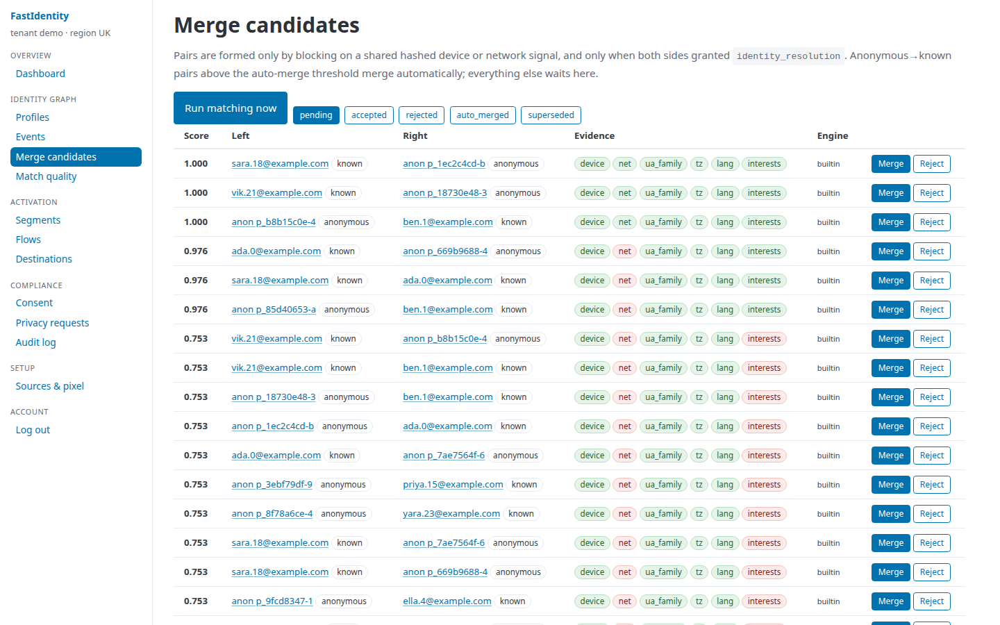
:::
::::

---

## 5. Identity graph — match quality

:::: split
::: txt
**Match quality** checks whether the matcher can be trusted.

- How auto, reviewed and deterministic merges break down.
- The score distribution of candidates.
- The **reviewer acceptance rate**: if staff reject many 0.9+ suggestions, raise `AUTO_MERGE_THRESHOLD`.
- The unmerge rate, which approximates the false-positive rate.

At larger scale, set `MATCH_ENGINE=splink` to fit the m/u parameters with EM on your own data instead of using the defaults.
:::
::: shot
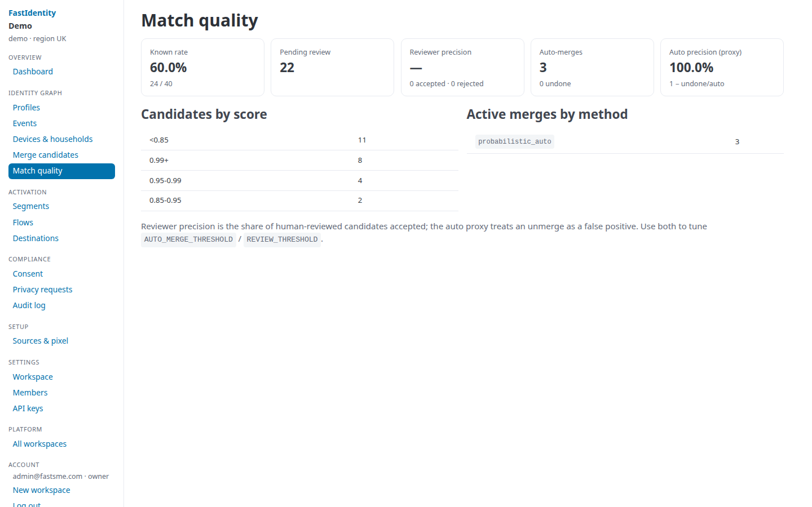
:::
::::

---

## 6. Activation — segments

:::: split
::: txt
**Segments** are saved audiences, defined as rules over traits, interests and recent events. For example: *viewed a knee-replacement package in the last 14 days, known, email-contactable*.

Segments feed flows and can be synced to a destination as a list. Membership is evaluated when a flow or sync runs, so segments never go stale.
:::
::: shot
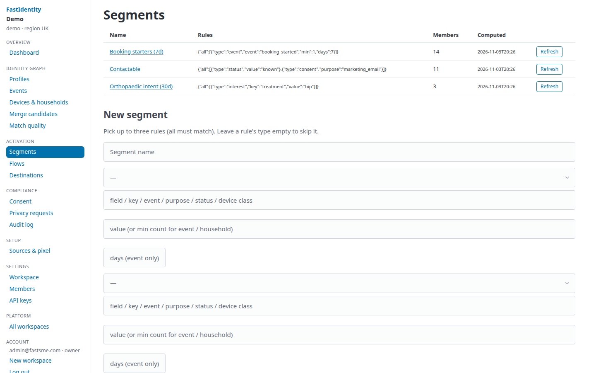
:::
::::

---

## 6. Activation — abandonment flows

:::: split
::: txt
A **flow** has a trigger event, an exit event, a delay and a lookback. Three templates ship with the product:

- **Browse abandonment**: viewed a treatment, then no enquiry within 24h.
- **Cart / quote abandonment**: started a quote, not completed.
- **Booking abandonment**: picked a date, did not book.

Before each send, the worker checks marketing consent, the hashed suppression list and the **frequency cap** (2 messages per 7 days by default). Skipped sends are recorded with the reason they were skipped.
:::
::: shot
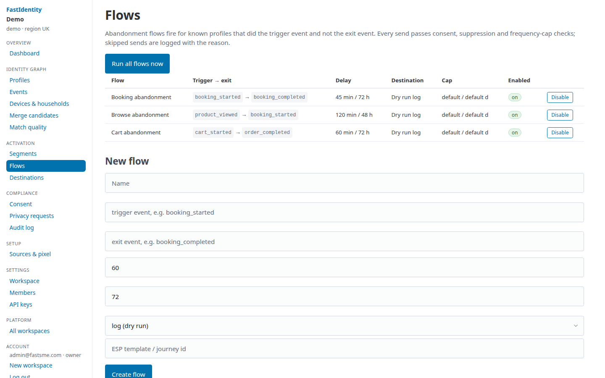
:::
::::

---

## 6. Activation — destinations

:::: split
::: txt
A **destination** is where activated events and profiles go.

- **Dry-run log**: the default. Shows exactly what *would* be sent.
- **Webhook**: an HMAC-signed POST to your own endpoint. This is the recommended way into MyMedicalGateway's Postmark sender.
- **Klaviyo**, **Customer.io** and **Braze** adapters, configured with API keys.

Details of each ESP are in `docs/esp_integration.md`.
:::
::: shot
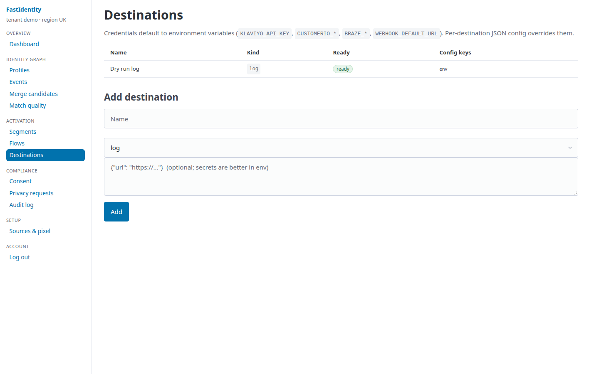
:::
::::

---

## 7. Compliance — consent ledger

:::: split
::: txt
Every consent change is **appended** to the ledger with a microsecond timestamp, its source, the legal basis and evidence (the CMP payload, the form wording and the page). Nothing is overwritten.

Purposes: `analytics`, `personalisation`, `identity_resolution`, `marketing_email`, `marketing_sms`.

**A cookie banner never grants email consent.** Marketing purposes come only from an explicit opt-in or the PECR soft opt-in. A withdrawal immediately adds the person's address to the suppression list. When two profiles merge, the most restrictive consent wins.
:::
::: shot
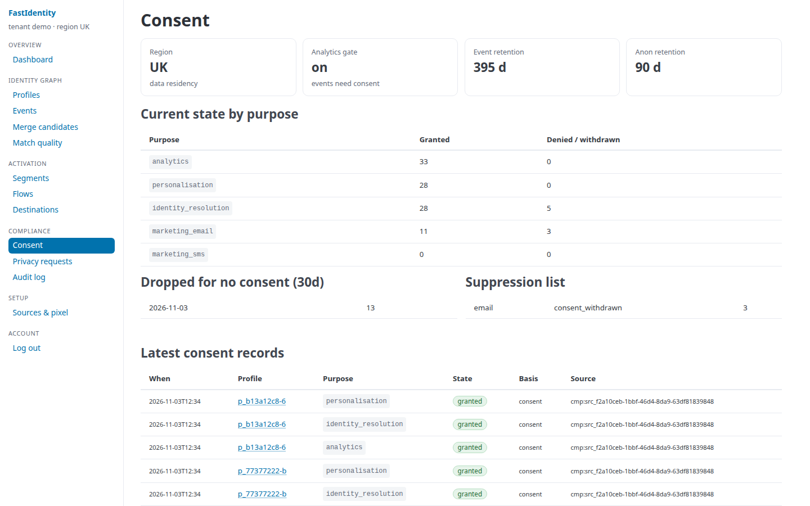
:::
::::

---

## 7. Compliance — privacy requests

:::: split
::: txt
**Privacy requests** handles GDPR Articles 15, 17 and 20.

- **Export (DSAR)**: a JSON file with the profile, identifiers, events, consent history and messages.
- **Erase**: deletes events, signals and identifiers and leaves a tombstone. The email or phone is kept only as a *hash* on the suppression list, so the person is never re-contacted.

The same operations are available server-to-server: `POST /v1/export` and `POST /v1/erasure`, authenticated with the admin token.
:::
::: shot
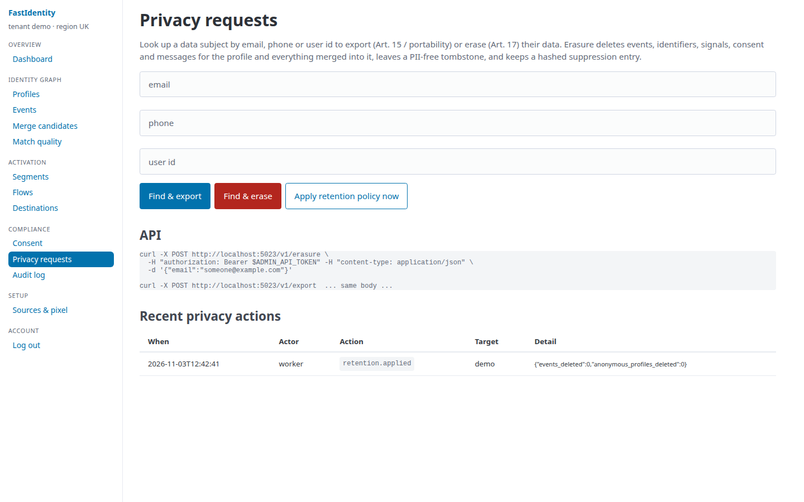
:::
::::

---

## 7. Compliance — audit log

:::: split
::: txt
The **audit log** is append-only. It records who did what, and when: staff logins, merges and unmerges with scores, consent changes, flow runs, erasures, and retention jobs.

It is the evidence trail for a DPIA, a regulator enquiry (ICO, or an EU supervisory authority), or a customer complaint.

Events older than 13 months (`EVENT_RETENTION_DAYS=395`) are purged automatically.
:::
::: shot
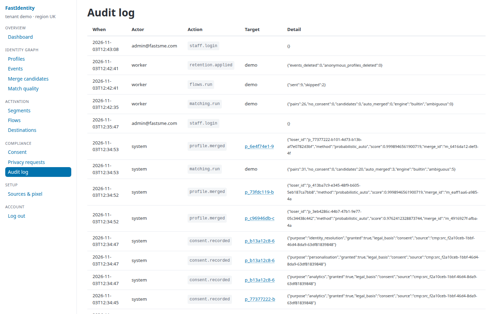
:::
::::

---

## 8. Setup — sources & pixel

:::: split
::: txt
A **source** is anything that sends data, and each has its own write key.

- **Website (js)**: the browser pixel. Restricted to allowed origins.
- **Backend (server)**: server-side `identify` and `track` calls.

The **snippet** goes in `<head>` after the CMP script:

```html
<script src="https://identity.fastsme.com/static/fi.js"
  data-write-key="WK_…" defer></script>
```

The pixel reads CookieYes, OneTrust or Consent Mode state. It sets its `_fi_aid` cookie only after analytics consent, and it sends device signals only with marketing consent.
:::
::: shot
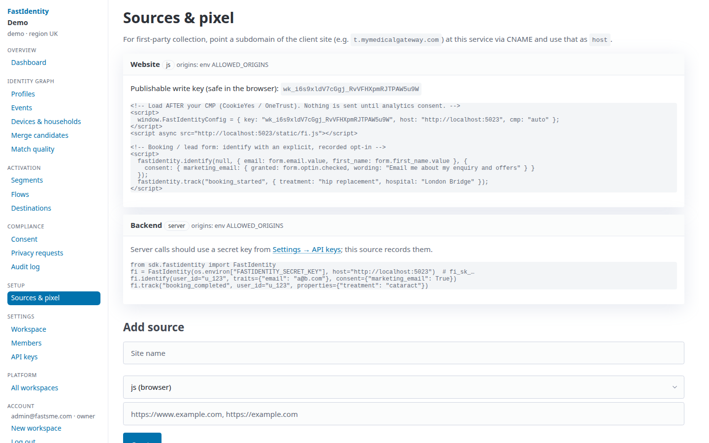
:::
::::

---

## 8. Setup — MyMedicalGateway: architecture

**Context.** mymedicalgateway.com is a server-rendered Flask app with Jinja templates. It uses **CookieYes** as its CMP, plus GTM, **Postmark** for email, Twilio for SMS, and an APScheduler worker (`mmg_scheduler`) that already sends time-based nudges.

```text
 Browser (mymedicalgateway.com)            MMG Flask backend                FastIdentity
 ─────────────────────────────            ──────────────────               ─────────────
 CookieYes banner ─┐
 fi.js pixel ──────┴── page / track ─────────────────────────────────────▶ /collect
                                           signup / login / enquiry /
                                           quote / booking / payment ────▶ /v1/identify, /v1/track
                                           account deletion ─────────────▶ /v1/erasure
                                           /integrations/fastidentity ◀── webhook destination
                                             └─▶ Postmark (broadcast stream)  (flow fired, HMAC-signed)
```

**Division of labour.**

- **FastIdentity owns** recognising the visitor before they enquire, and the *browse* and *package-abandonment* flows.
- **MMG's scheduler keeps** the post-quote transactional nudges (diagnostics, balance reminders, callbacks).
- One rule across both: **MMG checks FastIdentity's suppression list before any marketing send**, and the frequency cap applies to both senders.

---

## 8. Setup — MyMedicalGateway: integration steps

1. **Pixel** (`mmg/templates/base.html`): add `fi.js` after the CookieYes and GTM snippets. The write key comes from `FASTIDENTITY_WRITE_KEY` through the `inject_now` context processor (`mmg/__init__.py`).
2. **Page context**: on treatment and hospital pages, call `fi.track("treatment_viewed", {treatment, hospital, country})`. The package page `/hospitals/<country>/<hospital>/<treatment>/` is the main abandonment trigger; its `…/start` POST counts as `quote_started`.
3. **Identify (server)**: call `/v1/identify` from the `user_registered` signal, after login (`/post-registration-handler`, Google OAuth), and on `register_interest`. Use `str(user.id)` as `userId`, not `fs_uniquifier`, because Flask-Security rotates that value. Send the `receive_email/sms` flags as consent with basis `consent`.
4. **Conversion events (server)**: `enquiry_submitted`, `quote_created` (`/treatments/terms`), `booking_submitted` (`/book/submit`), `deposit_paid` (from the payment webhook). These are the flows' *exit* events.
5. **Logout**: call `fi.reset()` on the logged-out page.
6. **Consent capture**: add an explicit, unticked marketing-email opt-in to the patient enquiry and registration forms. Today these flags can only be edited in the provider app.
7. **Erasure and export**: add a patient account-deletion route to `user_bp`. It should call `/v1/erasure` and `/v1/export`; MMG has no such route today.
8. **Activation**: create a webhook destination pointing at `/integrations/fastidentity/webhook`. MMG verifies the HMAC and sends through Postmark's **broadcast** message stream, not the transactional one.
9. **Config**: add `FASTIDENTITY_URL`, `FASTIDENTITY_WRITE_KEY`, `FASTIDENTITY_SERVER_KEY`, `FASTIDENTITY_ADMIN_TOKEN` and `FASTIDENTITY_WEBHOOK_SECRET` to `.envs.example/*/patient.env`. Mark them skippable in `config/settings/base.py` so local development works without them.

---

## 8. Setup — MyMedicalGateway: health data & go-live

**Special-category data.** Interest in a specific treatment, linked to a named person, is *data concerning health* under GDPR Art. 9 and UK GDPR. For MMG this means:

- **Explicit consent** for treatment-specific marketing. Abandonment emails go only to people with `marketing_email` consent captured on a form, never under the soft opt-in.
- Email copy refers to the *destination or hospital*, never to the *diagnosis*. Subject lines must never reveal the treatment.
- A **DPIA** is completed before go-live, and FastIdentity is added to MMG's record of processing activities and privacy notice as a processor.
- Data stays in the UK region (`DATA_REGION=uk`). The ESP receives the minimum: an email address and a flow ID.

**Go-live checklist.**

- ☐ Pixel live on beta; consent drops visible on the dashboard
- ☐ identify / track events arriving from the backend; deterministic merges confirmed
- ☐ Webhook destination tested in dry-run, then a staff-only segment
- ☐ Erasure round-trip tested (MMG deletion → FastIdentity tombstone → suppression)
- ☐ DPIA signed off; privacy notice updated
- ☐ Production write keys rotated and stored in MMG's secret store

Tracking issue: [mymedicalgateway/mmg#1420](https://github.com/mymedicalgateway/mmg/issues/1420) (milestone: 4 November 2026).

---

## 9. Operating playbook

**Daily (5 minutes).**

- Dashboard: consent drops and pending merges.
- Clear the merge-candidate queue.

**Weekly.**

- Match quality: if the reviewer acceptance rate on 0.9+ candidates is above 95%, consider lowering the review threshold; if it is below 80%, raise `AUTO_MERGE_THRESHOLD`.
- Flows: check messages sent against messages skipped. A high "no_consent" count means the opt-in on forms needs work.

**Monthly.**

- Audit log spot-check.
- Confirm retention jobs ran.
- Review DSAR and erasure turnaround (the target is under 30 days; ours is instant).

**Deploy.** Push to `main` and the GitHub webhook triggers a Coolify build. The new version takes over only after the `/health` check passes. Manual operations: `python scripts/coolify.py status | env --sync --yes | deploy --yes`.

**Never rotate** `IDENTITY_HASH_SECRET` casually. It permanently breaks probabilistic linkage to all previously hashed signals.
